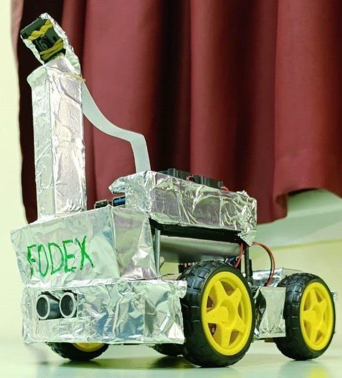
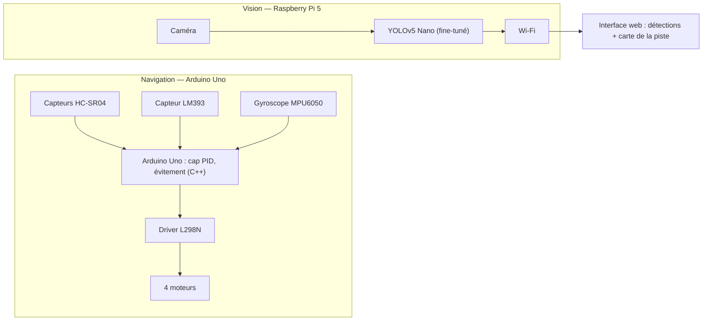
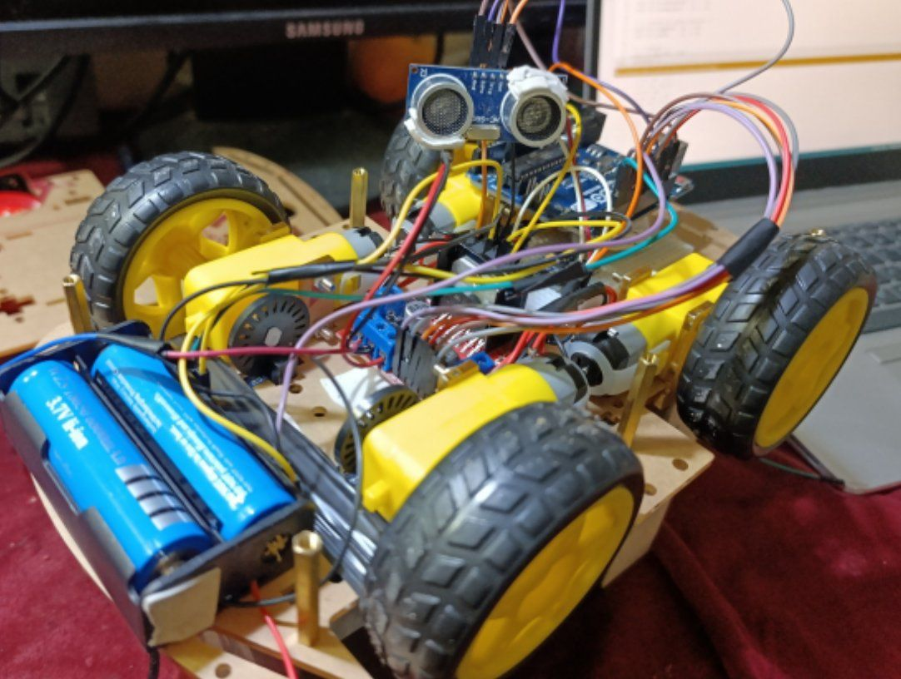
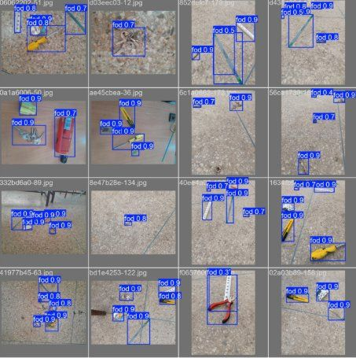
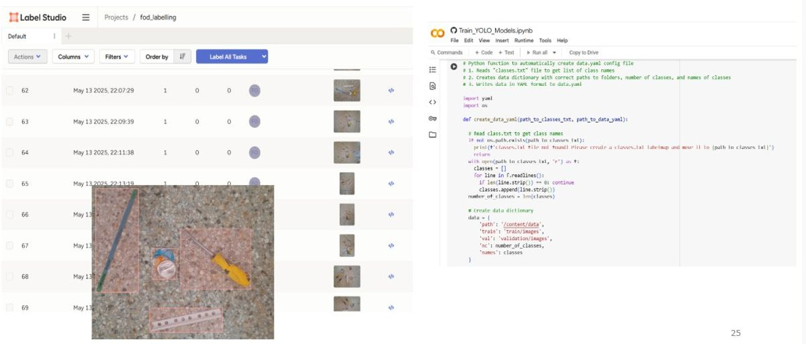
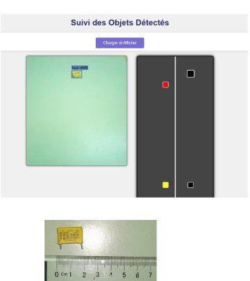

# FODEX — Robot autonome de détection de débris (FOD) sur piste

> *Autonomous robot that drives along a runway, detects Foreign Object Debris (FOD) with a YOLOv5 Nano model and reports their positions on a web map. Arduino Uno (navigation) + Raspberry Pi 5 (vision).*



## Contexte

Projet de fin d'année, 2ᵉ année du cycle ingénieur — filière Génie électrique, systèmes embarqués et télécommunications (ENSEM Casablanca), 2024-2025.
Projet réalisé en binôme avec **ADA Ouèssè Amédé**, encadré par Mme Soumia Bakkali. Soutenance le 18/06/2025.

Les FOD (*Foreign Object Debris*) posés sur une piste d'atterrissage menacent les avions au décollage et à l'atterrissage. Les inspections manuelles sont lentes et les systèmes fixes (radars, caméras) sont très coûteux. FODEX est une alternative **low-cost** : un robot mobile qui parcourt la piste, détecte les débris et cartographie les zones contaminées.

## Architecture

Deux plateformes embarquées aux rôles séparés.



| Fonction | Choix technique |
|---|---|
| Modélisation | Cahier des charges, SysML |
| Simulation | Déplacement du robot sous MATLAB/Simulink |
| Motorisation | 4 moteurs + driver L298N |
| Capteurs | HC-SR04, LM393, gyroscope MPU6050 (fusion de capteurs) |
| Navigation | *Dead reckoning*, correction de cap par PID, évitement d'obstacles (C++) |
| Détection | YOLOv5 Nano, fine-tuning sur ~203 images annotées (Label Studio), entraînement sur Google Colab |
| Calcul embarqué | Raspberry Pi 5 + caméra |
| Supervision | Envoi des résultats en Wi-Fi vers une interface web |

## Résultats

Prototype fonctionnel testé sur une piste rectiligne d'environ 3 m avec des objets de type FOD (bouteilles, pièces métalliques, outils).

- Détection correcte de **95 %** des objets en conditions normales. Les erreurs viennent surtout des très petits objets et du flou de mouvement.
- Cap stable et évitement d'obstacles dès **15 cm**.
- Retour au cap initial avec une erreur angulaire moyenne **inférieure à 3°**.

| | |
|---|---|
|  |  |
|  |  |

**Vidéo de l'essai du robot** (31 s : débris sans gêne pour le robot, débris de grande taille, manœuvre d'évitement) :

https://github.com/user-attachments/assets/eceb5512-579b-48bb-8f18-30c5cd1eb3d8


## Difficultés

## Pistes d'évolution

RTK-GPS pour un positionnement précis, LiDAR 2D, jeu de données plus large.

## Contenu du dépôt

```
images/   photos et captures du projet
src/      code (à compléter : sketch Arduino, scripts Raspberry Pi, notebook Colab)
docs/     schémas SysML, simulation Simulink
```

## Auteurs

Taha Jorfaoui
